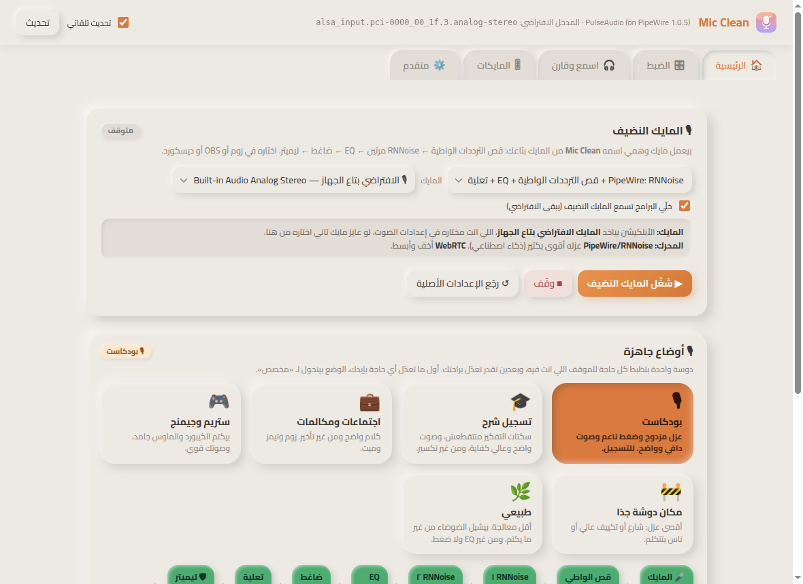

# Mic Clean

**Any mic, studio clean.** Mic Clean cleans up your microphone and gives every other app a clean virtual mic called **Mic Clean**. It runs RNNoise twice, then a 10-band EQ, a compressor and a limiter. You can hear and see the result live while you tune it. It runs on Linux, macOS and Windows with any mic, needs no account and sends nothing to the cloud.

[Download](https://mohamedjs.github.io/mic-clean/) · [Releases](https://github.com/mohamedjs/mic-clean/releases) · [بالعربي ↓](#بالعربي)



## Install

| | Download | Then | Pick this mic in Zoom/OBS |
|---|---|---|---|
| **Ubuntu / Debian** | `Mic-Clean-<v>-linux-amd64.deb` | `sudo apt install ./Mic-Clean-<v>-linux-amd64.deb` | **Mic Clean** |
| **Other Linux** | `Mic-Clean-<v>-linux-x86_64.AppImage` | `chmod +x` it and run it | **Mic Clean** |
| **Mac (Apple Silicon or Intel)** | Homebrew, or the `.dmg` | see [Opening it on a Mac](#opening-it-on-a-mac) | **BlackHole 2ch** |
| **Windows 10/11** | `Mic-Clean-Setup-<v>-windows-x64.exe` | SmartScreen: **More info → Run anyway** | **CABLE Output** |

```bash
brew tap mohamedjs/mic-clean https://github.com/mohamedjs/mic-clean
brew install --cask mic-clean
```

The app opens to **Home**. A **Is this computer ready?** card appears there when something is missing, with a button or a command to fix it.

| OS | Needs | How you get it |
|---|---|---|
| Linux | PipeWire (or PulseAudio) and `pactl` | Already there on Ubuntu 22.04+, Fedora and most desktops. The `.deb` depends on them |
| Linux | RNNoise | **Bundled** in the `.deb` and AppImage |
| Linux | `swh-plugins`, for the compressor and limiter | The `.deb` recommends it. Otherwise use the button in the app, or `sudo apt install swh-plugins` (Fedora/openSUSE: `ladspa-swh-plugins`) |
| macOS | [BlackHole 2ch](https://existential.audio/blackhole/), the virtual mic other apps record from | The Homebrew cask installs it. Otherwise `brew install --cask blackhole-2ch`, then restart once |
| Windows | [VB-CABLE](https://vb-audio.com/Cable/), the virtual mic other apps record from | Download it, run `VBCABLE_Setup_x64.exe` as administrator, then restart |

### Opening it on a Mac

Mic Clean is not notarised by Apple yet, because that needs a paid developer ID. The first time you open a downloaded copy, macOS says **“Mic Clean” Not Opened**. Click **Done**, not *Move to Trash*, then do one of these:

- **Homebrew** (easiest): the two commands above install the app and BlackHole and clear the warning.
- **Downloaded `.dmg`**: drag Mic Clean into Applications and open it once. Then go to **System Settings → Privacy & Security**, scroll down and click **Open Anyway**. Or run `xattr -dr com.apple.quarantine "/Applications/Mic Clean.app"`.
- The first time, allow the **microphone**.

On macOS and Windows the cleaning runs inside the app's window. Closing the window keeps it running in the tray or menu bar. To stop it, quit from the tray.

## How it works

```
Linux:          your mic ─► PipeWire filter-chain: high-pass ─► RNNoise ─► RNNoise ─► EQ ─► compressor ─► gain ─► limiter ─► "Mic Clean"
macOS/Windows:  your mic ─► app window (Web Audio + RNNoise WASM, same chain) ─► BlackHole / CABLE Input ─► apps record BlackHole / CABLE Output
```

- **Input:** the **system's default mic**, the one picked in your OS sound settings. You can pick another mic in the app. On Linux, while Mic Clean runs it becomes the default input so apps use it. When it stops, the default goes back to your real mic.
- **Presets:** 🎙 Podcast (the default), 🎓 Lecture recording, 💼 Meetings, 🎮 Stream, 🚧 Very noisy room, 🌿 Natural. Every preset ends in a limiter at −2 dBFS.
- **Tabs:** Home (ready check, start, presets, signal path) · Tune (every stage) · Listen and compare (A/B, meters, spectrogram, 10 s recording, gain calibration) · Mics · Advanced (old filters, engine log, configs, raw output).
- **Different mics:** works with USB mics, audio interfaces, laptop mics and Bluetooth. For a two-input interface with the mic on one input, pick input 1 or input 2 so the level is not halved. If the saved mic is gone, it uses the default mic. If a mic is unplugged, it restarts by itself when the mic comes back.

## Code layout

A modular monolith with no runtime dependencies: Node.js 18+ and the browser, nothing else.

```
electron/main.js          desktop app: window, tray, start at login, mic permission, cleanup on quit
server.js                 run without the app: node server.js → http://localhost:4747
src/
  server.js               picks the routes for this OS and starts the HTTP server
  core/                   config (name, paths, OS/mode), exec (commands), http (routes + static files), fsutil
  shared/presets.js       the presets, shared by the server and the window (one source of truth)
  modules/
    settings/             load/save/reset; defaults = the Podcast preset
    linux/                pactl parsing, default mic, chain config, engine, plugins, graph, legacy filters, routes
    mac/                  Core Audio devices, input volume, BlackHole
    windows/              audio devices through PowerShell, VB-CABLE
    deps/                 GET /api/deps: what this computer is missing and how to fix it
    migrate/              switches off the old "Mic (Mohamed)" autostart (the app used to be called Mic (Mohamed))
public/                   the window: index.html (markup), css/, js/ (dashboard, scenes, calibrate, setup, engine-web), js/audio/ (RNNoise worklet + WASM)
packaging/                icons, licences, Linux RNNoise fetch, macOS ad hoc signing
Casks/mic-clean.rb        Homebrew cask
scripts/                  run from source without the app: install-linux.sh, install-mac.sh, install-windows.ps1, reset-audio.sh
site/                     landing page (Arabic and English), deployed to GitHub Pages
video/                    the explainer video and how it was made
test/                     npm test: chain config, presets, pactl parsing and routes against golden files
```

## Develop

```bash
npm install          # Electron and electron-builder (dev only)
npm test             # checks, no sound server needed
npm run app          # the desktop app
npm start            # server only → http://localhost:4747
npm run dist:linux   # → dist/*.deb, dist/*.AppImage   (dist:mac / dist:win build on those OSes)
```

`MIC_PLATFORM=darwin|win32` shows another OS's window on Linux, and `MIC_ENGINE=web` forces the in-window engine.

## Releasing

1. Bump `version` in `package.json`, then run `npm test`.
2. `git tag v1.2.3 && git push origin v1.2.3`.

`.github/workflows/release.yml` builds Linux on ubuntu-22.04, macOS arm64 + x64 on macos-15 and Windows on windows-latest. It starts each build and takes a screenshot, then publishes the release with `SHA256SUMS.txt` and fixed-name copies (`Mic-Clean-macos-arm64.zip` …) for the cask and the landing page. Pushing a `feat/**` branch builds the same files as run artifacts without publishing anything.

Code signing has not been set up yet. The macOS builds are signed ad hoc, so users see **Open Anyway**. The Windows installer shows SmartScreen until it is signed with an OV/EV certificate.

## Coming from Mic (Mohamed)

The app used to be called Mic (Mohamed), and its virtual mic is now called **Mic Clean**, so pick it again in Zoom/OBS. On first start the desktop app switches off the old background service (`mic-mohamed.service`, `com.mohamed.mic`, or the Startup shortcut). Your settings stay where they were (`~/.config/mic-clean-dashboard/`). If the audio gets into a bad state on Linux, `bash scripts/reset-audio.sh` puts it back. It keeps your default mic and moves custom audio configs to `~/audio-backup-<date>`.

---

## بالعربي

**Mic Clean** أبلكيشن بينضّف المايك بتاعك ويعمل مايك وهمي اسمه **Mic Clean** تختاره في زوم وميت وOBS وديسكورد. الصوت بيعدي على RNNoise مرتين، وبعدين EQ وضاغط وليميتر، وانت بتسمع وبتشوف النتيجة live وانت بتظبط. شغال على لينكس والماك وويندوز ومع أي مايك.

- **التسطيب:** نزّل الملف المناسب لجهازك من [صفحة الأبلكيشن](https://mohamedjs.github.io/mic-clean/). على الماك الأسهل `brew install --cask mic-clean`. ولو الماك قالك «Not Opened» افتح **System Settings ← Privacy & Security ← Open Anyway**.
- **المايك:** الأبلكيشن بياخد **المايك الافتراضي بتاع الجهاز**، اللي انت مختاره في إعدادات الصوت، وتقدر تغيّره من جوه الأبلكيشن.
- **اللي محتاجه:** على لينكس RNNoise جاي جوه الأبلكيشن، والضاغط محتاج `swh-plugins` (فيه زرار يسطّبه). الماك محتاج BlackHole، وويندوز محتاج VB-CABLE. تاب «الرئيسية» بيقولك لو حاجة ناقصة وإزاي تجيبها.
- **في زوم/OBS اختار:** **Mic Clean** على لينكس، و**BlackHole 2ch** على الماك، و**CABLE Output** على ويندوز.
- **التابات:** الرئيسية (جاهز؟ + شغّل + الأوضاع الجاهزة) · الضبط · اسمع وقارن · المايكات · متقدم.

## License

MIT. Bundled: [rnnoise-wasm](public/js/audio/vendor/LICENSE) (Apache-2.0). The Linux packages also bundle the RNNoise LADSPA plugin from [werman/noise-suppression-for-voice](https://github.com/werman/noise-suppression-for-voice) (GPL-3.0). It ships as a separate program, and its licence is in `resources/licenses`.
